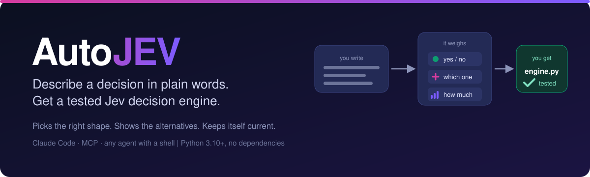
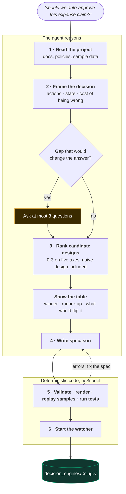
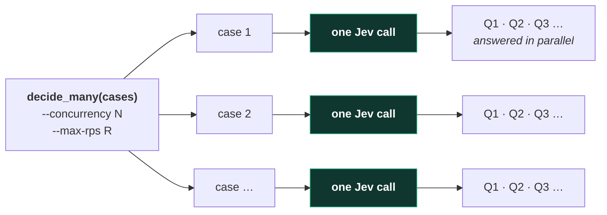
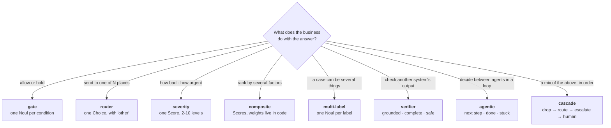
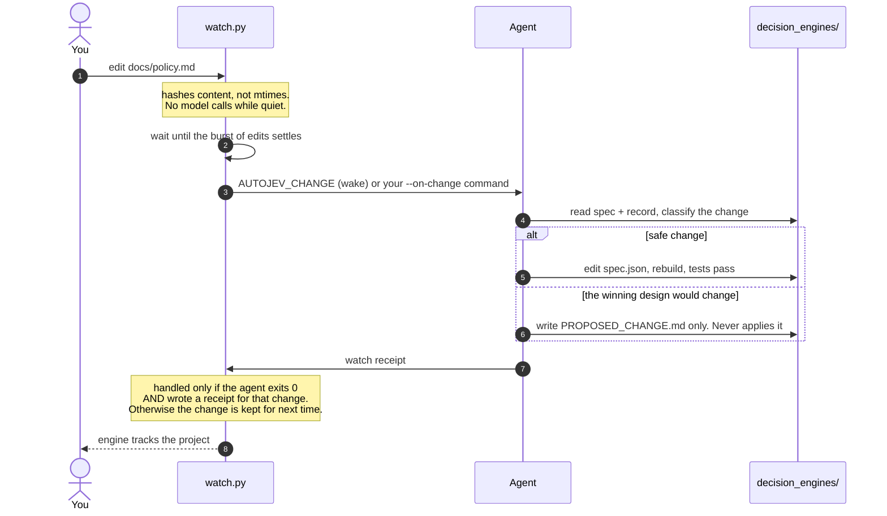
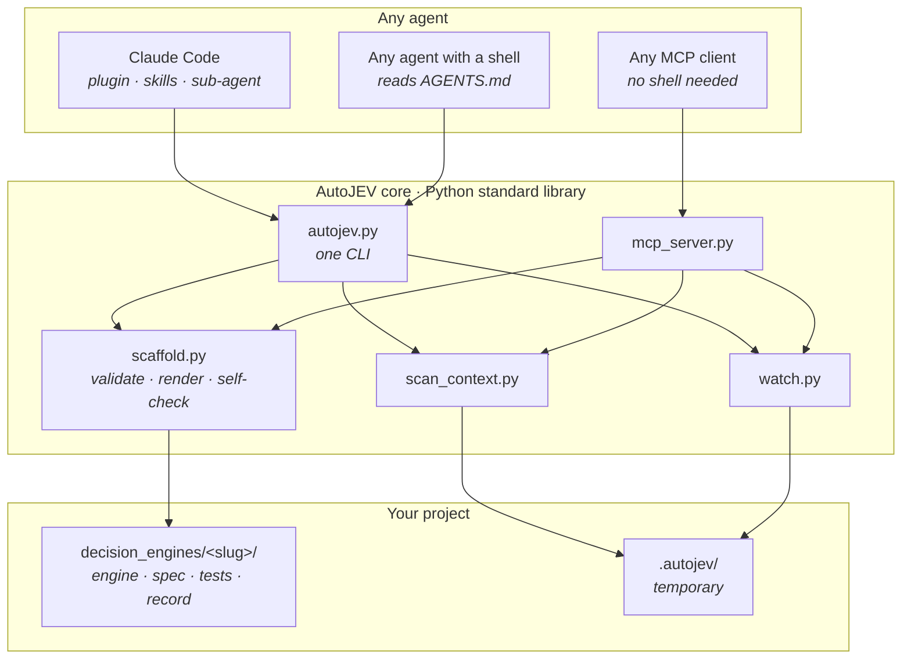

<div align="center">



<br>

[](https://github.com/exponen-agi/autojev/actions/workflows/test.yml)
[](LICENSE)


**Jev in self-service mode for business domains.**
Tell your coding agent the decision you need to make. AutoJEV works out what *kind* of decision it is,
shows you the alternatives it weighed, and builds a tested [Jev](https://github.com/exponen-agi/jev-playground)
decision engine, then keeps it current as your project changes.

[Quick start](#quick-start) ·
[How it works](#how-it-works) ·
[See the output](#what-you-get) ·
[Choosing a shape](#choosing-the-shape) ·
[The continuous loop](#the-continuous-loop) ·
[Other agents](#works-with-other-agents) ·
[FAQ](#faq)

</div>

---

## The problem

Jev answers three kinds of question: *is this true* (`Noul`), *which one* (`Choice`), and *where on a
spectrum* (`Score`). The hard part is rarely calling it. It is deciding, for a vague business
problem, **which of those the problem actually is**, how many separate questions it needs, where the
thresholds go, and what should happen when Jev isn't sure.

> *"Every inbound member message should go to the right desk, and anything risky should be flagged."*

Is that one multiple choice? Five yes/no flags? A score? A pipeline of all three? Most people guess,
build one combined "is this risky?" question, and discover later that they cannot tune it.

AutoJEV makes that meta-decision explicit, shows its reasoning, and only then writes code.

## Quick start

```bash
# 1. Install (Claude Code plugin)
claude plugin marketplace add exponen-agi/autojev
claude plugin install autojev@autojev

# 2. In any project, describe the decision. It checks for your Jev key first
/autojev should we auto-approve this expense claim, or send it to a manager?

# 3. Run what it built, and verify it against the real Jev
python decision_engines/expense-review-gate/engine.py --demo      # offline, no key
python decision_engines/expense-review-gate/engine.py --verify    # live, in parallel

# 4. When you are done
/autojev-stop          # stops the watcher, deletes temp files, keeps your engine
```

**Your Jev API key.** You can *build* an engine without one, but you cannot *verify* it, so AutoJEV
checks for a key before anything else and asks how you want to proceed. The key is a secret: it is
never requested in chat, printed, or committed.

```bash
python skills/autojev/scripts/autojev.py doctor            # is a key available? (never shows it)
python skills/autojev/scripts/autojev.py setup             # hidden prompt, saves .env (mode 600, git-ignored)
python skills/autojev/scripts/autojev.py doctor --verify   # does Jev accept it?
```

Or set `TYPESAFE_API_KEY` yourself, or copy `.env.example` to `.env`. In Claude Code, type
`! python <path>/autojev.py setup` so it runs in your own shell and the key stays out of the
conversation. Jev is in early access: [typesafe.ai](https://typesafe.ai).

Not on Claude Code? See [Works with other agents](#works-with-other-agents). Requires Python 3.10+
and nothing else. `typesafe-sdk` is needed only to call Jev live.

### Not only Jev: other backends

Live calls go to Jev by default. To answer with an LLM instead, install
[`system-one-adapter`](https://github.com/typesafe-ai/system-one-adapter-python) (a drop-in for the Jev
client that exposes the same `Noul` / `Choice` / `Score` questions over OpenAI, Anthropic or Gemini) and select it:

```bash
pip install 'system-one-adapter[openai]'          # or [anthropic] / [gemini]
python skills/autojev/scripts/autojev.py setup --backend openai    # hidden prompt, saves .env; sets AUTOJEV_BACKEND
export AUTOJEV_LLM_MODEL=<an exact model name>    # no default: model names move
python skills/autojev/scripts/autojev.py doctor --backend openai --verify
```

| `AUTOJEV_BACKEND` | Client | Key variable |
|---|---|---|
| `jev` (default) | `typesafe-sdk` | `TYPESAFE_API_KEY` |
| `openai` | `system-one-adapter` | `OPENAI_API_KEY` (`OPENAI_BASE_URL` for compatible endpoints) |
| `anthropic` | `system-one-adapter` | `ANTHROPIC_API_KEY` |
| `gemini` | `system-one-adapter` | `GEMINI_API_KEY` or `GOOGLE_API_KEY` |

The engine, its rules and its tests are unchanged. What changes is who answers, and that is recorded: the
receipt (`verification.json`), README and decision record say which backend answered, and a run on an LLM
is reported as **not verified against Jev**. An LLM's probabilities are not Jev's, so thresholds tuned on
one are not tuned for the other; recalibrate before switching. The key rules are the same (hidden prompt,
`.env` mode 600, never an argument).

## How it works



The agent does the reasoning (steps 1-4). Everything after is deterministic code that no model
touches: the scaffold validates the spec, renders the engine, replays every sample through the real
policy, and runs the generated tests.

### It shows its work before it builds

This is the real decision record from the shipped
[expense-review-gate](showcase/expense-review-gate/decision_record.md) example:

| design | shape | fit | actionability | risk_fit | data | simplicity | total | |
|---|---|:-:|:-:|:-:|:-:|:-:|:-:|---|
| **Independent Noul flags + code limit** | gate | 3 | 3 | 3 | 3 | 2 | **14** | **chosen** |
| Choice: approve / hold / reject | router | 2 | 2 | 1 | 3 | 3 | 11 | |
| One Noul: `needs_review` | gate | 2 | 1 | 1 | 3 | 3 | 10 | |
| Score: risk 0-4 | score | 1 | 1 | 2 | 3 | 3 | 10 | |

*Why it won:* each reason to hold a claim (looks personal, admits a policy exception, no receipt)
is its own yes/no with its own bar, and the dollar limit is checked in code, never asked of the
model. *Why the obvious one lost:* a single `needs_review` Noul hides three reasons in one number,
so you cannot tune "receipt" without moving "personal". *What would flip it:* if every held claim
were cheap and reversible, the single question would win on simplicity.

The naive design is always on the table, so you can see what you would have built.

## What you get

```text
decision_engines/expense-review-gate/
├── engine.py            questions · thresholds · policy() · decide() · CLI
├── spec.json            the source of truth. Edit it and rebuild
├── decision_record.md   designs considered, scores, assumptions, risks, revision log
├── samples.json         cases with the outcome each should reach
├── test_engine.py       behavioural tests, no key needed
├── verification.json    receipt from `--verify`: live result, model, tied to this exact spec
├── calibrate.py         confidence-vs-accuracy table on your own labelled data
├── jev_compat.py        the real SDK if installed, an offline stand-in if not
└── README.md
```

Browse two complete, real outputs in [`showcase/`](showcase). A test keeps them in sync with the
generator. The engine runs on its own, with or without AutoJEV:

```console
$ python decision_engines/support-ticket-triage/engine.py --demo
ok spam-seo                  -> drop                via drop_spam
ok duplicate-charge          -> fast_track_refund   via refund_fast_track
ok outage-furious            -> priority_queue      via escalate_priority
ok pricing-question          -> route_to_department via route
ok refund-but-policy-says-no -> route_to_department via route
ok ambiguous-owner           -> human_review        via default
ok owner-is-other            -> human_review        via default

(offline: canned answers. This exercises the rules, not Jev's judgment.)
```

The generated policy is plain, reviewable Python. Every threshold is a named constant with the
reason for its value beside it:

```python
SPAM_BAR = 0.85    # dropping a real customer is the costly error, so the bar is high
DEPT_FLOOR = 0.7   # a mis-routed ticket costs a hop, not a customer; below this a person decides

def policy(a, composite, state):
    # refund_fast_track: explicit refund ask, policy covers it, and billing is clearly the owner
    if a['refund_requested'].noul > REFUND_BAR and a['policy_supports'].noul > POLICY_BAR \
            and a['department'].choice == 'billing' and a['department'].confidence >= DEPT_FLOOR:
        return {'outcome': 'fast_track_refund', 'rule': 'refund_fast_track', ...}
    ...
    return {'outcome': 'human_review', 'rule': 'default', ...}   # "not sure" always has somewhere to go
```

## Verified, not just generated

Offline tests prove the rules route correctly *given assumed answers*. They cannot show that Jev's
real answers lead those rules to the right outcomes. `--verify` does:

```console
$ python decision_engines/support-ticket-triage/engine.py --verify
    sample                      expected              live Jev gave
ok  spam-seo                    drop                  drop
ok  duplicate-charge            fast_track_refund     fast_track_refund
!!  outage-furious              priority_queue        route_to_department
...
6/7 agree (86%; need 75%) · model jev-1.13.0 · 700 input tokens · p50 154 ms, p95 188 ms · 0.6s wall at concurrency 4
VERIFIED
```

(The layout is real; the numbers above are illustrative.) It also checks that every live answer stays inside
the answer space the engine declared, and writes a receipt, `verification.json`, containing the model
version that answered and a hash of the spec it was run against. **Change the spec and the receipt is
marked stale** in the engine's README and decision record, so a green badge cannot outlive the thing it
verified. If `TYPESAFE_BASE_URL` points anywhere but the default API (a proxy, a mock, a stub), the receipt and
the decision record say **custom endpoint** instead of claiming real verification, and `doctor` warns. The generated `test_engine.py` also carries live tests that run when a key is present and skip
with an explicit message when it is not.

A disagreement is information, not a failure to hide: either the expected outcome was a wrong guess, or a
question or threshold needs work. The workflow tells the agent never to edit an expectation just to pass,
and to report disagreements it leaves in place.

## Parallel by design

Jev evaluates **every question of a case in parallel, inside one call**, so a decision costs one round
trip however many questions it asks. AutoJEV designs for that (ask everything up front; do not split a
decision across calls unless one answer genuinely feeds the next) and adds a second level for batches:



```bash
python engine.py --jsonl cases.jsonl --concurrency 4 --max-rps 15   # results in input order
```

It uses the SDK's async client, spaces request starts to stay under the published limit (1,200 requests a
minute), isolates a failing case so it cannot stop the batch, and stops at once on a rejected key rather
than hammering the API. `calibrate.py` and `--verify` use the same path.

## Choosing the shape

The meta-decision at the heart of the project. The full rubric and the traps next to each shape are
in [`decision-shapes.md`](skills/autojev/references/decision-shapes.md).



Five axes, 0-3 each, score every candidate:

| Axis | Asks |
|---|---|
| **fit** | does the answer space match what the business reasons in? |
| **actionability** | does every answer map to exactly one action in code? |
| **risk_fit** | do the bars and the human path match the cost of being wrong? |
| **data** | does the state this needs actually exist in the project? |
| **simplicity** | fewest questions that still separate the actions |

## The Jev rules it enforces

Generated engines follow the patterns from [jev-playground](https://github.com/exponen-agi/jev-playground),
and the build **lints** for the ways Jev is known to go wrong. Findings are warnings in the build and
are written into the decision record, never hidden.

| Rule | What the linter does |
|---|---|
| One judgment per question; ask everything up front | questions are independent; extra ones are nearly free |
| Keep arithmetic, dates and hard limits in code | `jag-arithmetic` flags wording about counts or dates; `state` rules check limits in `policy()` |
| Jev reads literally; negation hurts | `jag-negation` flags negated `Noul` wording |
| Give a `Choice` an escape | `choice-no-escape` when there is no `other` |
| One threshold per action, scaled to the cost of being wrong | `t-why`: every bar needs a stated reason |
| An automatic action needs a calibrated bar | `auto-no-bar` |
| "Not sure" needs somewhere to go | `no-escape-hatch`, `default-auto` |
| Send only the fields a question needs | `state_fields` trims what reaches Jev |
| Test every rule and outcome | `rule-unexercised`, `outcome-unreached` |

## The continuous loop

Nothing runs "forever" in the abstract. What runs is a small script that watches your project, and an
agent that is woken only when something changes.



| | What counts as "safe" (applied) | What is only ever proposed |
|---|---|---|
| **Recalibrator** | clearer wording, a new sample from a real case, a new state field, a threshold moved with evidence, a resolved assumption | the top design changing, a different primitive behind a question, removing an outcome, widening any automatic action |

It keeps a backup, rebuilds through the scaffold, and rolls back if the build or tests fail. It is
idempotent per change, so two sessions reacting to one event cannot record it twice.

**It lives as long as your agent session does** (or as long as the handler process you start does).
`watch.py` expires after 8 hours by default. `/autojev-stop` or `autojev.py stop` ends it any time,
removes `.autojev/`, and never touches your engines.

## Works with other agents

The tooling is standard-library Python and the workflow is plain Markdown, so nothing is tied to
one vendor. Only the packaging differs.



| Agent | Status |
|---|---|
| **Claude Code** (plugin, skills, sub-agent, wake-on-exit loop) | Run end to end: build, change, recalibrate, stop |
| **Claude Code, no plugin, no shell**, only the MCP server | Run: built an engine through the tools alone |
| **Handler mode with `claude -p`**, no plugin | Run: recalibrated a change, receipt confirmed |
| Codex CLI, Gemini CLI, Cursor, other SDKs | **Not run.** Documented from their public interfaces; treat as a starting point |

How to wire each one up, including the exact commands and tool grants, is in
[`docs/portability.md`](docs/portability.md). If you run it under another agent, a one-line note in
that table is the most useful contribution you can make.

```bash
AUTOJEV="python skills/autojev/scripts/autojev.py"
$AUTOJEV --help          # scan · build · validate · check · watch · stop · playbook · ref · example · prompt
```

## Trust and safety

Generated code and background processes deserve suspicion, so these are deliberate:

- **No key, no network** to build or test. Offline fixtures prove the *rules* route correctly. They do
  not and cannot show how Jev will judge your data; engines and their decision records say so, and
  show **NOT verified against Jev** until `--verify` has run.
- **Your API key stays out of the transcript.** `doctor` reports status and source, never the value.
  `setup` takes it from a hidden prompt or stdin (never an argument, which shows in process lists), writes
  `.env` with mode 600 and git-ignores it. No MCP tool accepts the key. Tests prove nothing prints it.
- **Spec text is inert.** Titles, rationales and comments from a spec are escaped before they reach
  generated code, so a prompt-injected line in a project file cannot become executable code. A
  hostile-spec test guards this.
- **The MCP server cannot start the watcher or run a command.** It writes only under
  `decision_engines/<slug>/` and rejects any slug outside `[a-z0-9-]`.
- **Handler commands belong to the operator.** AutoJEV never builds one from model or project text.
- **A handler's exit code is not trusted.** An agent that says "I couldn't read the file" still exits 0;
  the watcher requires a receipt, and keeps unconfirmed changes.
- **The watcher is cleaned up properly.** It verifies a pid is its own before signalling, kills a
  handler's whole process group, and `.env*`, `.git` and dependency folders are never read.
- **Recalibration is bounded.** It edits only through the spec, rolls back on failure, re-verifies live
  when a key is available, and proposes rather than applies any change of design.

**What was tested, honestly.** The live code paths (auth, parallelism, pacing, retries, receipts) were
tested with the real `typesafe-sdk` against a local stand-in server that speaks the real wire format. That
proves the plumbing. AutoJEV has **not been run against the production Jev API** in development, and the
stand-in's answers are scripted, so nothing here says how Jev judges your data. Your first `--verify` is
the first real test.

## FAQ

<details>
<summary><b>Does AutoJEV call an LLM, or Jev?</b></summary>

No. Your agent does the reasoning in the workflow. The scripts are deterministic and call no model.
The *engines it builds* call Jev, and only when you give them a `TYPESAFE_API_KEY`. The one exception
you trigger yourself is `doctor --verify`, which makes a single tiny request to check the key.
</details>

<details>
<summary><b>Do I need a Jev API key, and where does it go?</b></summary>

To build an engine and test its rules: no. To *verify* it against Jev: yes. AutoJEV checks first and asks
how you want to proceed (add it privately, set the environment variable, or continue offline and be told
the engine is not verified). It is stored only in the environment or a git-ignored `.env` (mode 600), and
is never printed, logged, put in a receipt, or accepted by an MCP tool. If you paste it into a chat anyway,
treat it as exposed and rotate it.
</details>

<details>
<summary><b>Why a spec and not hand-written code?</b></summary>

Because the interesting changes (a threshold, a new question, a new sample) become a reviewable diff
of `spec.json`, and the engine is re-rendered and re-tested from it. The cost: **hand edits to a
generated `engine.py` are overwritten on rebuild.** Put custom logic in a wrapper that imports the
engine, or in the spec's rules.
</details>

<details>
<summary><b>How is this different from asking an agent to "write me a classifier"?</b></summary>

It forces the decision you would otherwise skip: it compares designs and shows the losers, gives
every threshold a stated reason, insists on a human path, lints for Jev's known failure modes, tests
every rule, and records assumptions so the watcher can revisit them when your project changes.
</details>

<details>
<summary><b>Are the thresholds right?</b></summary>

They are first guesses with a written reason each. They become evidence only after
`calibrate.py` has bucketed real answers against your own labelled cases and accuracy rises with
confidence. Until then: run Jev in shadow, change no behaviour, keep a person on the low-confidence
path.
</details>

<details>
<summary><b>What can't the generated rules express?</b></summary>

Conditions within a rule are ANDed and rules are first-match-wins. That covers gates, routers,
severity, weighted composites and cascades. Anything stranger (loops, cross-case state) is code you
write around the engine. Jev itself takes text only and cannot generate text; where a design needs
writing, it says where a generative model hands off.
</details>

<details>
<summary><b>Is it safe to run on my repository?</b></summary>

It reads documentation and data files, skips secrets and dependency folders, and writes only to
`decision_engines/` and `.autojev/`. It adds `.autojev/` to `.gitignore` if you use git. See
[Trust and safety](#trust-and-safety).
</details>

<details>
<summary><b>Where does Jev come from?</b></summary>

Jev is TypeSafe AI's System One model, in early access. This project is independent and
unofficial. The patterns it follows, and a set of interactive simulations, live in
[jev-playground](https://github.com/exponen-agi/jev-playground).
</details>

## Repository layout

```text
.claude-plugin/        plugin + marketplace manifests (Claude Code packaging)
AGENTS.md              entry point for any other agent
skills/autojev/        SKILL.md (the workflow) · references/ · examples/
                       scripts/  autojev (CLI) · scan_context · watch · scaffold · stop · mcp_server · templates/
skills/autojev-stop/   SKILL.md (calls autojev.py stop)
agents/                autojev-recalibrator.md  (the procedure is references/recalibrator.md)
showcase/              two complete generated engines, kept in sync by a test
docs/                  portability.md · assets/
tests/                 end-to-end tests, including real watcher and MCP processes
```

## Development

```bash
python -m unittest discover -s tests -v     # standard library only
claude plugin validate .
```

Contributions are welcome: see [CONTRIBUTING.md](CONTRIBUTING.md). Security issues: see
[SECURITY.md](SECURITY.md). Release notes: [CHANGELOG.md](CHANGELOG.md).

## License

[MIT](LICENSE). This is an independent, unofficial project and is not affiliated with TypeSafe AI.
Jev figures and behaviour referenced here are as published by TypeSafe and are vendor-reported.
